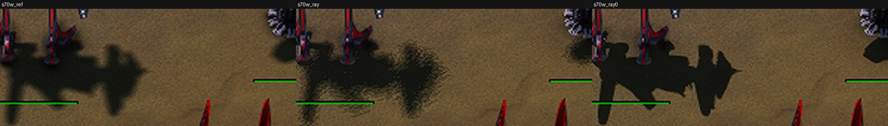

# Ray tracing (ray-traced shadows, ambient light, bounce light, water reflections)

Direct3D 12 and Vulkan on GPUs with inline ray queries (DXR 1.1 / `VK_KHR_ray_query`). Direct3D 11 cannot trace and the rows are not listed there. Everything is off until the player turns it on
(`ren_RayTracedShadows 0`), and **stays off by default**: measured against the cascade shadows it is not clearly better, and it costs much more than it was documented to (below).
Switches: [SWITCHES.md](SWITCHES.md) (`ren_RayTracedShadows`, `ren_RayShadow*`, `ren_RaySunAngle`, `ren_RaySoftRays`, `ren_RayAlphaShadows`, `ren_RayAo*`, `ren_RayBounce*`, `ren_RayWaterReflections`).
Filter and AO background: [SHADOW_FILTERING.md](SHADOW_FILTERING.md), [AMBIENT_OCCLUSION.md](AMBIENT_OCCLUSION.md).

## How it works

Each frame `RayScene::Submit` (`src/moho/render/RayScene.cpp`, called from the shadow pass) builds one top-level structure: the ground as height-field tiles of 64 x 64 cells (mask 1, rehashed 64 a
frame after the heights change), and one bottom-level piece per skin bone of every mesh in the shadow pass's whole-view batch (mask 2; trees by alpha texture, at most 64 textures). The effect
layer (`src/gpg/gal/effects/ModernHlsl.cpp`, `kRayShadowHelpers`) rewrites each shadow lookup of `mesh.fx` / `terrain.fx` to rebuild the point in world space and trace towards the sun, so the stock effects are unchanged. The
backends build the pieces (`backends/d3d12/RayTracingD3D12.cpp`, `backends/vulkan/RayTracingVulkan.cpp`) and bind the structure to every effect draw. Ray AO (`AmbientOcclusionShader.h`), bounce light
(`BounceLightShader.h`) and water reflections (`kRayWaterHelpers`) trace the same scene.

## What was measured here (2026-11-12)

Machine: Radeon RX 7900 XTX, windowed 1600 x 900, `adaptive_acid_lakes`, the staged scene of `tests/featab` (`AB_SCENE rays`: the census structures of four factions, eight idle units, a wall, four gunships and 14
trees, 814 ray instances), game paused so frames compare, GPU times from the render profile (`FAF_GPU_PROFILE`, the minimum over the blocks of a step; other sessions used the GPU, so the absolute numbers are noisy and the order of magnitude is the point).
Arms: **cas** the shipped cascades at 2048; **ref** the best the shadow map does (`ren_ShadowSize 4096`, `ren_ShadowFilter 4`); **hard** `ren_RayTracedShadows 1`, `ren_RaySunAngle 0`; **soft** the same with `ren_RaySunAngle 3` (what
the option "Soft ray-traced shadows" did by default). The sun is the map's (34 degrees) or set with `ren_SunTestElevation` / `ren_SunTestAzimuth`.

### Cost (GPU ms per frame, whole frame)

| Sun, view | cas | ref | hard | soft | Terrain pass cas / hard / soft | Meshes pass cas / hard / soft |
|---|---|---|---|---|---|---|
| D3D12, 70 degrees, wide | 5.3 | 5.8 | 10.2 (+4.9) | 20.4 (+15.1) | 0.4 / 1.6 / 3.5 | 0.5 / 2.2 / 6.1 |
| D3D12, 70 degrees, close | 4.7 | 4.5 | 7.8 (+3.1) | 13.2 (+8.5) | 0.5 / 1.5 / 3.0 | 0.2 / 0.9 / 3.0 |
| D3D12, 12 degrees, wide | 4.4 | 4.5 | 7.5 (+3.1) | 19.9 (+15.4) | 0.3 / 2.0 / 6.9 | 0.4 / 1.4 / 5.8 |
| Vulkan, 70 degrees, wide | 4.5 | 4.7 | 7.1 (+2.7) | 17.8 (+13.4) | 0.3 / 1.1 / 3.4 | 0.4 / 1.5 / 6.3 |
| Vulkan, 70 degrees, close | 4.2 | 4.3 | 5.1 (+0.8) | 9.2 (+5.0) | 0.3 / 0.9 / 2.3 | 0.2 / 0.5 / 2.1 |
| Vulkan, 12 degrees, wide | 4.5 | 4.5 | 8.6 (+4.2) | 25.7 (+21.3) | 0.3 / 1.9 / 6.9 | 0.4 / 2.0 / 8.6 |

The upstream numbers (SWITCHES.md: +0.6 to +1.0 ms hard, +0.1 to +0.3 more soft, TITAN RTX, a few hundred units) do not hold on this card: hard is +1 to +5 ms (a doubling of this light scene's frame), soft is +5 to +21. The cost
sits in the lit passes (`Terrain`, `Meshes`), not in the acceleration structure (the `Shadows` pass, which builds it, goes from 0.2-0.5 to 0.3-1.1 ms). It grows with the screen share of ground and units and with the
number of rays a pixel traces (soft: five filter taps on every unit pixel, four mesh rays and one ground ray on every ground pixel, each ray on a hit followed by an up-ray and a second ray).

### Quality against the best shadow map

Mean absolute difference over the 1000 x 580 crop of the units, against **ref** (levels of 255; the same on D3D12 and Vulkan to two decimals):

| Sun, view | cas | hard | soft |
|---|---|---|---|
| 70 degrees, wide | 0.54 | 0.46 | 0.47 |
| 70 degrees, close | 0.29 | 0.45 | 0.46 |
| 12 degrees, wide | 0.37 | 0.55 | 0.67 |
| 12 degrees, close | 0.13 | 0.29 | 0.52 |

Hard rays are as close to the reference as the cascades at a high sun and further from it at a low one. They are not clearly better, so the default stays Off. What they do differently:

- **Terrain shadows are physical and hard.** Hills shade the ground with the full sun term and a crisp edge (a ray straight to the sun cannot soften), where the cascades' baked terrain shadow darkens by 0.45 and is soft. At 12 degrees the ray-traced ground shows large dark patches with straight edges
  that the cascades do not have; they are right, but the game's look changes.
- **Soft shadows are a stipple.** With `ren_RaySunAngle 3` and `ren_RaySoftRays 4` a penumbra is four rays turned per cell of the world: a grainy edge at 11 times the real sun's radius (0.27 degrees):

  

  Left to right: the reference, soft 3 degrees, 0.3 degrees. Hard shadows (`ren_RaySunAngle 0`) are clean.
- **Ray ambient light is darker than the Standard screen kernel, and about as dark as GTAO.** Measured against the other kernels in the section "Ray ambient light" below: no bias on open ground, 15 to 25 percent stronger than GTAO High on occluded surfaces, three times the Standard kernel.
- The scene holds what the shadow pass batches (the shadow volume over the view), as the shadow map does. The option tip of the ray-traced shadows says so ("within the range the shadow map covers"; the older wording "exact at every distance" went in 7dc5b77f0).

## Defects found and what was done

| # | Defect | Evidence | Status |
|---|---|---|---|
| 1 | Soft shadows were the default of the soft option (3 degrees) and cost 5 to 21 ms on this card | table above | **Fixed:** `ren_RaySunAngle` defaults to 0, the option "Soft ray-traced shadows" is Off by default (its key was renamed `ray_soft_shadows_optin`, so a profile that stored the old default does not keep it) and its tip states the cost |
| 2 | Soft penumbra is a visible stipple at 4 rays | crop `r2_c70z` | Not fixed: more rays cost more; documented. An adaptive version (two probe rays on opposite sides of the disc, the rays of the spiral only where they disagree) removed the stipple but did not make the frame cheaper (Terrain pass 4.4 to 4.6 ms at 4 penumbra rays, 6.5 to 9 ms at 12) |
| 3 | A mesh point's ground shadow was traced again for every one of the five filter taps although it does not depend on the tap | Meshes pass 7.8 to 4.9 ms in one A/B pair (soft, D3D12, wide); later soft runs read 6.1 to 8.6 ms, so the saving is within the noise of this shared GPU: a logical saving of one ray in five on unit pixels, not a measured one | **Fixed** (`faf_ray_ground_value`, keyed like the lookup's own cache) |
| 4 | "Ray-traced bounce light" and "Ray-traced water reflections" had no `requiresRayTracing`, so Options > Video listed them on Direct3D 11 and on GPUs that cannot trace | `GetOptionsData()` on Direct3D 11 now lists none of the ray rows | **Fixed** |
| 5 | The shader is at the edge of what the AMD compiler and driver tolerate | A second mesh probe in the lookup (two more ray queries per mesh lookup, with the caching of the first) hung the GPU (`DXGI_ERROR_DEVICE_HUNG`, 0x887A0006) in the first frames with rays on, reproducibly on Direct3D 12, with soft rays 4 and 12 and with the probe as a loop of one trace site; the version without it (and the one with the adaptive ground probes) ran 18 steps and 130 frames | Reverted. Any change to the lookups needs a soak on the 7900 XTX |
| 6 | Cost scales with the lit passes' ray count | table | Documented; the cheap ways left are a coarser caster grid in front of the mesh rays (skip rays that cannot meet a caster) and tracing at half resolution with a joint upsample, both bigger than a bias or a default |

The cost items of that paragraph are examined below ("Cost items, 2026-11-12").

## Other checks

- **Trees (alpha shadows):** on Ozone Seas (a jungle map) with rays on, the palm and bush shadows are present and cut by the leaf texture (`ren_RayAlphaShadows 1`); mean difference of the frame to the cascades' 7.7 levels, i.e. a visibly different but plausible canopy shadow. In the acid-lakes scene the 14 staged props did not show in the cameras used, so nothing is claimed there. Thin structures (a 36-piece wall, radar masts, the Seraphim spires): hard rays and the cascades agree on their shadows; soft rays make them grainy (the soft crops).
- **Direct3D 11:** `GetRenderFeatures().rayTracing` is false, `GetOptionsData()` lists no ray row (the bounce and water-reflection rows used to be listed there, see defect 4), and the frame with `ren_RayTracedShadows 1`, `ren_RayBounce 1`, `ren_RayWaterReflections 1` is identical to the frame with them off (mean difference 0.000 over three frames).
- **Direct3D 12 and Vulkan:** the cost and quality table was measured on both (the same scene, 30 steps each); no device removal with the defaults of this branch (the shipped lookups, ground cache) over 3 runs of 18 to 30 steps; the reverted probe version hung Direct3D 12 at once (defect 5). Host tests: `faf_gal_tests` 111 of 111 (including the two ray shader compile tests for both targets, DXIL and SPIR-V).

## Water reflections: ray-traced and screen-space

`ren_RayWaterReflections` needs `ren_RayTracedShadows` (its scene), and while it traces, `WaterReflections.cpp` sets the march's steps to 0 (`tracedReflections`: `gRayShadows.vectors[8][0] > 0`), so SSR steps aside as intended and is back when the scene is not published (rays off, or the device
could not build it: the constants are zeroed, so the check follows the frame, not the cvar). Staged views (a lake on `adaptive_acid_lakes`, the sea of Ozone Seas; heading looking along and across the shore, a top view; `none` / `ren_WaterSSR 1` / ray water with SSR on):

| View | SSR against none (mean level) | ray water against none |
|---|---|---|
| lake, grazing | 0.32 | 1.03 |
| lake, across the shore | 0.07 | 2.67 |
| lake, top | 0.00 | 1.10 |
| sea, grazing | 0.79 | 1.52 |
| sea, across the shore | 0.00 | 7.72 |
| sea, top | 0.01 | 2.79 |

Reading of that first pass: the ray rows included the ray-traced shadows (water reflections need them), so it was confounded. The isolated comparison is below.

### Isolated comparison (fix/rays2, 2026-11-12)

Rays shadows on in every arm (hard, `ren_RaySunAngle 0`), the game paused so frames compare, `ren_Taa 0`, 1600 x 900. Arms: **Z** the shipped default (rays off, SSR on); **A** SSR on, ray water off; **B** ray water on (SSR steps aside); **D** B with `ren_RayWaterDepthTest 0`; **C** neither. Ozone Seas (the sea, deepest water at 255.9 / 778.5, 21 units deep) and `adaptive_acid_lakes` (a shallow acid lake at 73.5 / 343.5). Views: a long look along the shore (g3), looking across the water at the shore at pitch 0.2, 0.12 and 0.06 radians (n0, n1, n4), straight down (t). GPU is the Water pass of the render profile, the mean of the profile windows of a step, three repeats of each arm on D3D12 (two on Vulkan); the machine was shared, so differences under about 0.05 ms are noise.

| Water pass, Ozone, view g3 | Z | A (SSR) | B (ray water) | D (B, no depth test) | C (neither) |
|---|---|---|---|---|---|
| D3D12, ms | 0.65 | 0.59 / 0.60 / 0.62 | 0.45 / 0.48 / 0.47 | 0.48 | 0.36 / 0.36 / 0.43 |
| Vulkan, ms | 0.63 | 0.57 / 0.57 | 0.47 / 0.40 | 0.50 | 0.35 / 0.32 |

SSR costs +0.23 ms over neither, the traced reflection +0.10 to +0.12 ms (one ray against a 32-step march), the depth check 0.00 to 0.02. Mean difference over the water band (levels of 255), D3D12 / Vulkan:

| View | A against B | A against C | B against C | B against D |
|---|---|---|---|---|
| sea, n0 | 3.26 / 3.28 | 2.79 / 2.66 | 2.29 / 2.26 | 0.00 / 0.02 |
| sea, n1 | 3.19 | 3.02 | 2.20 | 0.04 |
| sea, n4 | 4.19 / 3.95 | 3.60 / 3.29 | 2.59 / 2.65 | 0.07 / 0.03 |
| sea, g3 and top | 0.25 and 0.02 | 0.13 and 0.00 | 0.22 and 0.02 | 0.00 |
| lake (acid), n0 / n1 / n4 | 0.81 / 1.24 / 0.08 | 0.65 / 1.20 / 0.15 | 0.59 / 0.99 / 0.11 | not run |

(The lake rows were measured before the depth check existed, with the older ray water; the Water pass there reads 0.13 ms for A and B and 0.10 ms for C.)

Crops (n4, the grazing view): the traced version mirrors the far hills, the shore and the units as soft darker shapes in the water, the marched one reflects less of the hills; both darken the wave crests' sun glint. The differences are small in all views because both water bodies are dark and opaque: the reflection is weighted by a Fresnel term of 0.03 to 0.08, so a view that is not grazing barely shows it. The acid lake (2.5 units deep, green) shows almost nothing in any arm.

**Recommendation.** With ray-traced shadows on, ray water is the better reflection: it finds its hit exactly (ground, units and trees, nothing the 32 steps skip), costs about half of SSR in the water pass, and now checks the hit against the scene depth. Without ray-traced shadows (the default) SSR is the only choice, and stays on. Both only reflect what is on the screen. The row "Ray-traced water reflections" stays Off by default: it needs the ray scene, which costs 1 to 5 ms, and the picture differs from SSR by 2 to 4 levels at the most, not clearly better.

**The depth defect.** The traced hit's colour came from the refraction copy at the hit's screen position with no depth test. `faf_ray_water` now also returns the hit's distance along the view axis; where water2.fx has the water reflection patch's scene depth (`FafWaterSceneZ`), the call site fades the hit out where the depth at that pixel differs from it by more than 0.75 units plus 2 percent of the distance (the sky stays), controlled by `waterSsrParams2.w` (1 while the depth copy is bound; `ren_RayWaterDepthTest 0` clears it). The depth copy is now also made when only the traced reflections need it. In the staged views the arms with and without the check differ by 0.00 to 0.07 levels, i.e. no hit was occluded in them: the fix is guarded and free (0.00 to 0.02 ms), but not shown to change a picture here. A hit the check rejects falls back to the sky; falling back to a marched hit was not done (SSR is off while the scene traces).

## Ray ambient light against screen kernels (2026-11-12)

`adaptive_acid_lakes`, the staged scene (close view 22 / 0.6, wide view 70 / 0.95), rays shadows on, hard. Mean darkening against `ren_AmbientOcclusion 0` over the crop, and in patches (percent of the patch's luminance):

| Kernel | wide, mean levels | close, mean levels | open ground | under the big building | building side |
|---|---|---|---|---|---|
| Standard (`ren_RayAo 0`) | 0.57 | 0.79 | 0.00 | 7.3 % | 10.6 % |
| GTAO Medium | 1.58 | 2.22 | 0.04 | 22.2 % | 20.6 % |
| GTAO High | 1.71 | 2.33 | 0.10 | 23.1 % | 21.0 % |
| Ray AO, 6 rays (`ren_RayAo 1`, default) | 1.43 | 2.54 | 0.00 | 26.4 % | 29.9 % |
| Ray AO, 16 rays | 1.44 | 2.55 | 0.00 | 26.7 % | 30.1 % |

Reading: it is neither a sampling bias nor an origin artefact. On open ground the traced kernel darkens by 0.00 (the rays start above the surface, `TracedUnderGround`), 6 and 16 rays give the same mean (0.01 to 0.1 level apart), and the darkening sits on occluded surfaces only (the building's own recesses, the ground in its shade). It is kernel strength: a hit adds `0.35 + 0.65 * (1 - t / radius)` and the sum is scaled by `1.5 * ren_AoIntensity`, so a hit counts 0.5 to 1.5 where a visibility fraction would count 1 at most; that makes it 15 to 25 percent darker than GTAO High and about 3 times the Standard kernel, which is the weakest. That gain is a look decision and was left alone. Cost, quiet-machine repeat: the AmbientOcclusion pass 0.25 ms (6 rays), 0.57 ms (16 rays), against 0.23 ms for GTAO High, 0.09 ms Standard, 0.07 ms Medium.

**Coexistence.** One kernel runs at a time, and the traced one wins while the frame's shadows are traced: with `ren_RayAo 1` and GTAO High selected the frame is identical to ray AO alone (0.00 levels), and with `ren_RayAo 0` the GTAO frame stands (it differs from ray AO by 1.3 to 1.5 levels).

## Ray bounce light (2026-11-12)

First look. The staged scene (close and wide view), rays shadows on, hard, `ren_RayBounce` 0 against 1 (and 16 rays, and strength 3), D3D12:

| Arm | mean change over the crop | 99.9th percentile | GPU, BounceLight pass |
|---|---|---|---|
| 4 rays, strength 1 (default), wide | +0.27 levels | +12 | 0.36 ms |
| 4 rays, strength 1, close (3 repeats) | +0.64 | +24 | 0.33 to 0.34 ms |
| 16 rays, wide | +0.27 | +12 | 1.04 ms |
| 4 rays, strength 3, wide | +0.87 | +31 | 0.32 ms |

The effect is very subtle on this dark map: a faint warm halo in the shade next to lit buildings and light on the units' undersides; the 8x amplified difference shows a fine stipple on the far ground (4 rays a point, blurred over 4x4 half-resolution samples: about one level, not visible without amplification). 16 rays do not change the mean and cost three times as much. No hard edges, haloes or flicker were found, so nothing was changed; the method is a plausible cosine-weighted one bounce (the receiver's colour times one plus the mean of the lit colours the rays meet, fading with distance); what it cannot do (hits off the screen or under water give nothing) is in SWITCHES.md. Not visibly better than off, so it stays Off.

## Cost items, 2026-11-12

- **Top-level structure rebuilt every frame.** The rebuild was about 0.35 ms of the Shadows pass in the staged scene (814 instances plus the ground tiles; 0.43 to 0.47 ms with rays on before, 0.07 to 0.09 after). The device now keeps the structure while the instance list, the per-instance records, the alpha textures and the set of pieces (made or destroyed: a freed range may be reused at the same address) are unchanged (`RayTracingD3D12.cpp`, `RayTracingVulkan.cpp`). That is an idle or paused scene; in a game whose units move the list changes every frame and the structure is rebuilt as before: the new profile region "RayScene" reads 0.1 to 0.3 ms GPU in the moving battle of the soak scene (about 1000 instances) and 0.000 when the structure is kept. Implemented, effective only in static scenes.
- **First sight of a mesh built in the middle of the frame.** A log line (frames that build more than 2 ms of pieces) measured it: switching rays on built 362 pieces / 74000 triangles in 7.5 ms on the render thread, 688 pieces / 137000 triangles in 17 ms on a busier machine. `ren_RayBuildBudget` (default 24000 triangles a frame, about 2.5 ms; 0 off) spreads that over frames (152 pieces / 24000 triangles in 2.5 ms, three frames, instance counts 387, 685, 800); a held-back mesh is reported missing as a mesh the device could not build, so the shadow map keeps the traced materials until it is in. In a normal game the new unit types per frame are far below the budget.
- **Trees traced unswayed.** Examined: the swaying props (`UndulatingNormalMappedAlpha`, the trees) move a vertex by `0.003 * position.y * sin^2(0.05 * time - dot(wind, position)) * windDirection` (the editor's copy of the vertex shader in `CD3DEffectTechnique.cpp` repeats mesh.fx's formula): 3 mm per metre of height times the wind vector, so a 10 unit tree moves a few centimetres at most. The static acceleration structure is exact to that. Verified OK, nothing to do.

## Soak (3 minutes or more, rays on, nuke and many units)

A `soak` staged scene (kept in the scratchpad, not committed): the census structures, a wall, 14 trees, a moving battle (16 to 40 units a side, all four factions, T1 to T4) and a nuke every 25 s, with all ray features on (shadows, ambient light, bounce, water reflections) and toggled during the run (soft and hard, alpha on and off, shadows off and on, AO rays 6 and 16, water and bounce off and on), the camera between the base, the lake and the ground. D3D12: 17 steps, 283 profile windows (about 34000 frames), 12 nukes, 6.5 minutes. Vulkan: 232 windows (about 28000 frames), 12 nukes, about 4 minutes. No device removal, validation message or crash on either, with `ren_RayBuildBudget` at its default and the kept-structure path (idle stretches included). The paused staged runs of the water tests (D3D12 and Vulkan) exercised the kept-structure path with changing options. Battle frame time 8 to 18 ms wall, GPU 5 to 12 ms.

## Options > Video rows (verified 2026-11-12)

`GetOptionsData()` from the running game: D3D12 and Vulkan list, in this order after the shadow rows: Ray-traced shadows (`ray_traced_shadows_optin`, default Off), Ray-traced ambient light (`ray_traced_ao_optin`, default Off since 2026-11-13, like every ray option; it acts only while ray-traced shadows trace; the key was `ray_traced_ao` with default On), Soft ray-traced shadows (`ray_soft_shadows_optin`, Off), Ray-traced water reflections (`ray_water_optin`, Off), Ray-traced bounce light (`ray_bounce_optin`, Off); 44 video rows. D3D11 lists none of them (36 rows, `rayTracing=false`), and its frames with `ren_RayTracedShadows 1`, `ren_RayBounce 1`, `ren_RayWaterReflections 1` equal the frames with them off (0.01 levels, the noise of two identical frames). The registry move of the bounce and water rows kept their keys and defaults. Tips: the ray-traced shadows tip already says "within the range the shadow map covers" (the wrong text was replaced in 7dc5b77f0); the other four tips match what the rows do, and the soft row states its cost.
