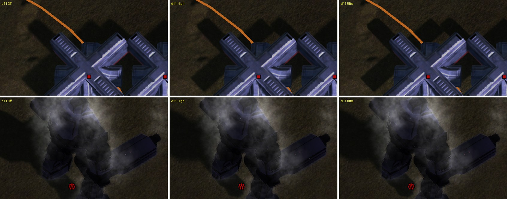
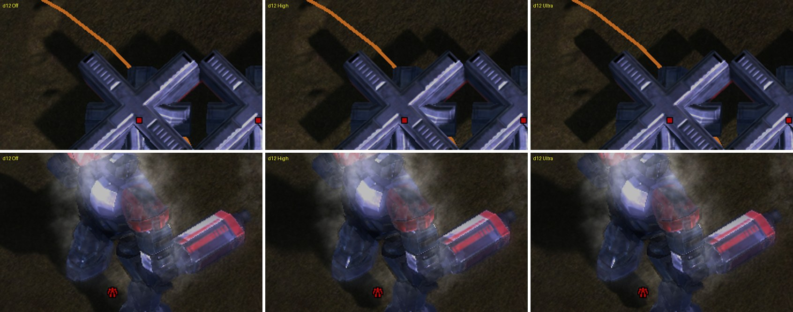
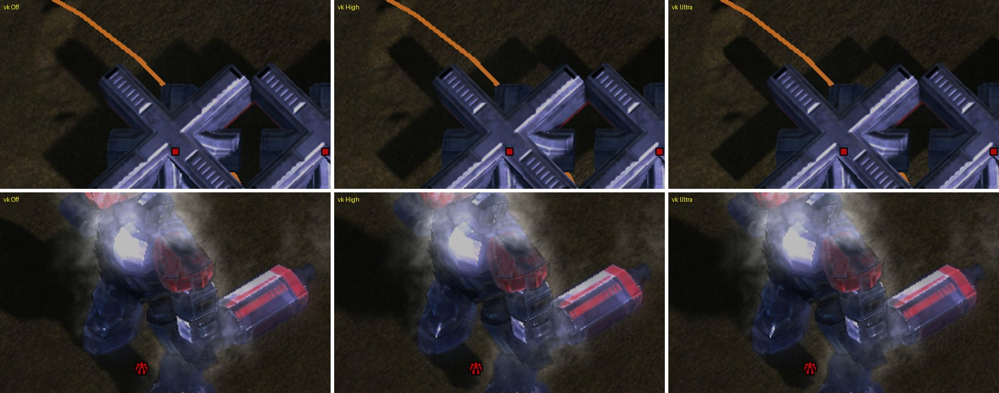

# Shadow filtering

Filtered, softer shadows for units, structures and the ground they stand on, a larger shadow map, and optional contact hardening. Engine only: the game's data files are not changed. The setting is **Options, Video, Shadow Filtering** (render feature `shadow_filter`, console variable `ren_ShadowFilter`, levels Off / Low / Medium / High / Ultra); it applies at once, no restart.

*Snapshot: 27/10/2026. Branch `shadow-filtering` (cut from `dynamic-lights`). Not to be confused with FAF's own Shadow Fidelity (`shadow_quality`, `shadow_Fidelity`) and Shadow Resolution (`shadow_resolution`, `ren_ShadowSize`) options, which stay as they are.*

## How the shipped renderer makes shadows

All of it is in `src/moho/render/Shadow.cpp` (one `Shadow` per viewport) and the shipped `mesh.fx` / `terrain.fx`.

1. `PrepareLightCamera` fits an orthographic light volume to the part of the view frustum that is within `ren_ShadowCoeff * zoom` of the camera and above the terrain (and only while the camera is closer than `ren_ShadowLOD`).
2. `RenderShadowMap` draws every mesh with the `Depth` techniques into a **1024 x 1024** colour target (`ren_ShadowSize`; FAF's Shadow Resolution slider goes up to 2048): **R = light-space depth** (cleared to 1), **G = 0** wherever a caster was drawn (cleared to 1). The terrain is not drawn into the map, so it never shadows anything.
3. With `ren_ShadowBlur` (on) two separable 5-tap passes (`THorizontalBlurDepthToVariance`, `TVerticalBlurDepthToVariance` in `terrain.fx`) blur the G channel into a second pair of targets.
4. **Meshes** (`ComputeShadowPCF` in `mesh.fx`) sample the raw map with five bilinear taps in a plus-shaped pattern, one texel apart, and compare each with the receiver's depth: a fixed 5-tap kernel, no slope bias, `ren_ShadowBias` (0.005) + 0.001 as the only bias. Bilinear filtering of a depth map blends caster depth with the background along every edge.
5. **The ground and the decals** (`ComputeShadow` and six more sites in `terrain.fx`) read the *blurred G channel* with one bilinear tap. It is a blurred silhouette mask of everything that casts: it knows no depth, so a ridge between the sun and a unit is shadowed by the unit, and every shadow has the same softness whatever the distance to its caster.

## What this adds

| Level | Shadow map (at least) | Lookup, meshes and ground | Blur passes |
|---|---|---|---|
| Off | FAF's `ren_ShadowSize` (1024) | shipped | on |
| Low | 1024 | 8 taps, rotated disk, radius 1.5 texels | not run |
| Medium | 2048 | 12 taps, radius 2 texels | not run |
| High | 2048 | blocker search (8 taps) + 16 taps, radius 1.5 to 6 texels (contact hardening) | not run |
| Ultra | 4096 | blocker search (8 taps) + 24 taps, radius 2 to 10 texels | not run |

`ren_ShadowSize` (FAF's Shadow Resolution slider) can still ask for a larger map than the level's; Off leaves it exactly as it was, and the user's value is never overwritten by a level.

The lookup (`ShadowFilterLookup`, generated by `src/moho/render/shadow/ShadowEffectPatch.cpp`) is shared by `mesh.fx` and `terrain.fx`:

- **Depth comparison on the ground too.** With the filter on, the ground reads the raw map (R = depth) and compares the receiver's depth, exactly like meshes. A unit only shadows what is behind it, as seen from the sun. The two blur targets are not allocated any more, which pays for the larger map (Ultra: one 4096 target instead of three 1024 ones).
- **Rotated Vogel disk.** The taps sit on an equal-area golden-angle spiral; the disk is rotated per shadow-map texel by interleaved gradient noise. The noise is fixed to the shadow map (the world), so nothing shimmers when the camera moves. Tap weights fall off towards the rim.
- **Receiver-plane bias.** The slope of the receiver's depth over the shadow map is derived from the screen-space derivatives of the shadow coordinate (`ddx`/`ddy`), and every tap compares against the receiver depth moved along its plane. A wide kernel on a slope no longer shadows its own surface, so the constant bias is halved (`ren_ShadowFilterBias`, default 0.5; `ren_ShadowFilterSlope`, default 1, scales the plane term). Checked at a very close view: bias 0.25, 0.5, 1 and slope 0 give the same picture on the commander and the ground.
- **No bias on the ground.** The ground is not drawn into the shadow map, so a ground pixel cannot shadow itself; its lookup uses no constant bias and no plane term (only meshes do). With the bias on, the ground right next to a unit's base (where the caster's surface is closer to the ground than the bias) counted as lit and a strip of sun appeared between the base and its shadow, as if the shadow had come loose from the unit (seen 2026-10-28 at a 3x crop of a structure's foot, D3D12; the same crop after the change has the shadow reaching the foot). Meshes keep `ren_ShadowFilterBias` / `ren_ShadowFilterSlope`.
- **Contact hardening (High, Ultra).** A first pass over 8 taps within the largest radius averages the depth of the casters in front of the receiver. The kernel radius is `(receiver depth - blocker depth) * penumbra scale`, clamped between the level's smallest and largest radius: a shadow is sharp where the object touches the ground and softer further away. The penumbra scale is derived from the light volume (`Shadow::PrepareLightCamera` reports its width and depth range) and the light's angular size (tan 0.04). No blocker in the search disk returns "lit" at once, which also makes most of the screen cheaper.
- **Hardware comparison samplers are not used.** The shadow map is a colour target the depth pass writes (depth in R together with the G mask), not a depth texture, so `SampleCmp` / a Vulkan comparison sampler would need a different depth pass. The comparison is done in the shader on single-texel fetches (`tex2Dlod`), which is the same on every API. On the ground effect `terrain.fx` has no sampler to spare (a pass of it already uses all 16 that shader model 4.1 allows), so its taps read the shipped bilinear `ShadowSampler` at texel centres, which returns exactly that texel.
- **Not done:** PCSS on the ground reads the *meshes'* depth only; the terrain itself is not a caster in the shipped map, so hills still do not cast shadows (that would be a different feature: drawing the terrain into the map).

## Shader side: how it coexists with the dynamic lights

Both features patch `mesh.fx` and `terrain.fx` as the text is read (`CD3DEffect::InitEffectFromFile`). They touch different places (this patch: the shadow lookup functions and the `tex2D(ShadowSampler, ...).g` sites; the lights: the vertex shaders, the PBR helper area and the technique list) and share one patch point instead of fighting over the text:

1. `assembleSource` in `CD3DEffectTechnique.cpp` is the single place that builds the text of an effect. It runs the shadow patch first and hands its output to the lights patch (`LightEffectPatch`), which only needs its own anchors. A source with CRLF line ends is normalised to LF by the shadow patch (the lights patch's anchors are LF).
2. Each patch that was applied adds a tag to the cache name (`mesh.dynlights.shadowf.<version>`), so every combination compiles to its own cached effect.
3. A patch that does not recognise the source (a FAF update moved something) leaves the text as it was and logs why; the effect then compiles without it (`ShadowFilter: mesh not patched: ...`). If the filtered effect does not compile on a device (Direct3D 11 compiles at load), the effect is built again without the filter and with the lights patch alone, and the filter stays off (`Active()` needs both effects patched).
4. The host test (`tests/shadow/ShadowEffectPatchTests.cpp`, `FAF_STOCK_FX_DIR`) applies both patches in both orders and checks the result.

The patch is applied on the backends that take the Direct3D 10 effect dialect (Direct3D 11, 12, Vulkan) whatever the level: the level is a shader parameter (`shadowFilter.x` / `ShadowFilter.x` = tap count; 0 runs the shipped code), so it switches live and an Off/On comparison is possible inside one run. One frame costs two `float4` parameter writes per effect.

Parameters of the patched text (all set by `ShadowFilter.cpp` every frame): `float4 shadowFilter, shadowFilter2` in `mesh.fx`, `ShadowFilter, ShadowFilter2` in `terrain.fx`. `x` taps (0 = shipped), `y` radius in texels, `z` largest radius, `w` penumbra scale; `filter2.x` bias scale, `filter2.y` plane bias scale.

## Per API

| API | Shadow Filtering | Notes |
|---|---|---|
| Direct3D 12 | Off, Low, Medium, High, Ultra | verified (screenshots, GPU time) |
| Vulkan | Off, Low, Medium, High, Ultra | verified (screenshots, GPU time) |
| Direct3D 11 | Off, Low, Medium, High, Ultra | verified (screenshots, wall time; GPU timestamps are not usable there) |
| Direct3D 9 | **not offered** | Tried, does not work with the shipped shaders. D3DX9 has no dynamic loops, so the taps were compiled in (8 of them); that text fails with `error X5589: Invalid const register num: 32. Max allowed is 31`: shader model 2 has 32 pixel constant registers and the shipped ps_2_a lit techniques already use most of them. D3DX9 also rejects an early `return` and `[unroll]`. A D3D9 lookup would have to compute its tap offsets instead of holding them as constants and be checked against the 512 instruction slots technique by technique, and the level could not be switched at run time. The shipped D3D9 shadows stay. |
| Direct3D 10 | not offered | the renderer does not start |

Default: **Off** on every API, like the other render features of this fork; Medium is the level to try first (a 2048 map, 12 taps, no contact hardening).

## Measured

*RX 7900 XTX, `adaptive_acid_lakes` seed 7, paused staged scene (`tests/shadow/ingame`: 16 units, 8 structures, 12 wall pieces, 3 air units around the commander, camera zoom 45), 3840x2160 windowed, `FAF_GPU_PROFILE=150`, 11 modes in a row (Off, Low, ... Ultra, Off, Ultra ... Low, Off, 9 s each, the two profile blocks after a switch dropped, then averaged per mode). Milliseconds of GPU time per frame; the numbers of one run drift by up to 0.3 ms with the card's clocks, so differences below that are noise.*

| Pass | Off | Low | Medium | High | Ultra |
|---|---|---|---|---|---|
| D3D12 `Shadows` (map + blur) | 1.05 | 0.28 | 0.41 | 0.40 | 0.55 |
| D3D12 `Terrain` (ground lookups) | 0.27 | 0.91 | 1.04 | 0.73 | 0.76 |
| D3D12 `Meshes` (unit lookups) | 0.15 | 0.13 | 0.14 | 0.12 | 0.14 |
| **D3D12 sum** | **1.47** | **1.32** | **1.59** | **1.25** | **1.45** |
| Vulkan `Shadows` | 0.40 | 0.23 | 0.26 | 0.46 | 0.48 |
| Vulkan `Terrain` | 0.25 | 0.48 | 0.59 | 0.46 | 0.49 |
| Vulkan `Meshes` | 0.06 | 0.06 | 0.07 | 0.08 | 0.09 |
| **Vulkan sum** | **0.71** | **0.77** | **0.92** | **1.00** | **1.05** |
| D3D11 wall ms/frame (4K, paused, mean) | 4.47 | 4.74 | 4.85 | 4.53 | 4.42 |

The ground lookups cost 0.2 to 0.8 ms at 4K (every pixel of the screen does a lookup), and dropping the two blur passes gives back about as much, so the filter is **roughly cost-neutral**: between -0.2 and +0.35 ms on the sum of the three passes, 0.3 to 0.5 ms in the worst case (Vulkan High / Ultra). The larger maps cost little: the depth pass draws the same meshes. High is cheaper than Medium on the ground because the blocker search ends most pixels early. Memory: Ultra uses one 4096 target plus its depth buffer where Off uses three 1024 targets (the blur ones).

## What was seen

Paired screenshots of the same paused frame, Off / High / Ultra, a wall piece with the shadows of its neighbours (top row) and the commander (bottom row), camera zoom 14, 2x:

Off to Off is identical after cycling the levels (the shipped path is restored: the only difference is the label text). Off shows the shipped blurred mask: soft smudged edges, a ghost halo along the shadow, no contact detail; Low to Ultra show the sharper shape of the casters and a clean edge and, from High on, a penumbra that widens with the distance to the caster. The three APIs draw the same picture. The difference is a refinement, not a different look: on this dark map the shadows are low contrast, and a close crop (2x) shows it best.

## Not verified

- Direct3D 9 (not offered, see above); Direct3D 10 (does not start).
- The option stored in a profile and applied at start (`ApplyStartupSettings`), and the Options screen drawn on screen; the entry's presence, text, default and its setter were exercised from Lua (`GetOptionsData()`, `set('shadow_filter', 'high')`).
- Several viewports at once (split screen): the shader parameters are set per frame for the viewport that rendered its shadows last.
- Shadows on steep slopes and on other maps, long games, replays.
- The `FAF_SHADER_PRECOMPILE=1` path with the patched effects (the effects are compiled lazily on D3D12 and Vulkan in the runs above).

## Files

| File | What |
|---|---|
| `src/moho/render/shadow/ShadowEffectPatch.{h,cpp}` | The text patch of `mesh.fx` and `terrain.fx` (pure text in, text out) |
| `src/moho/render/shadow/ShadowFilter.{h,cpp}` | Levels, console variables, shader parameters, the registry entry |
| `src/moho/render/Shadow.cpp` | Map size and blur follow the filter; light volume reported for the penumbra scale |
| `src/moho/render/d3d/CD3DEffectTechnique.cpp` | `assembleSource`: the chain of the two patches, cache tags, fallback |
| `src/gpg/gal/backends/d3d11/DeviceD3D11.cpp` | The compile error list of a failed effect starts with its errors (a long effect printed only warnings in the first 1500 characters) |
| `tests/shadow/ShadowEffectPatchTests.cpp` | Host test (`faf_shadow_tests`; set `FAF_STOCK_FX_DIR`) |
| `tests/shadow/ingame/` | The staged scenes and cycling scripts used above |
