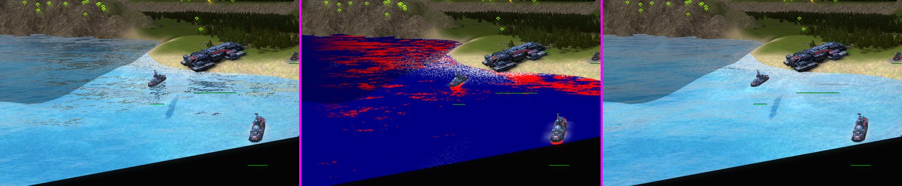
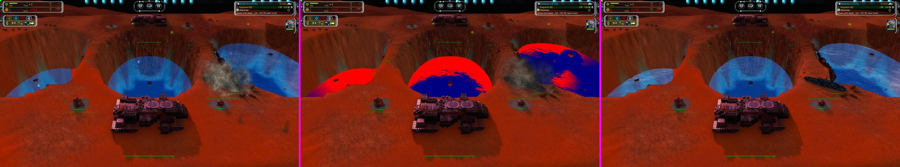

# What the water shows of the scene around it

The water pixel shader (`water2.fx`, `HighFidelityPS`) knows the sky, the mirrored units of the planar reflection pass and the refraction copy of the scene.
This patch adds what a player expects to see in a lake or a sea and the shipped shader cannot: terrain, buildings and trees in the reflection, a thickness
that follows what is really under the surface, caustics on a shallow bed, a Fresnel term that does not light up grey streaks, and the shade of units and buildings.
**Render only**, Direct3D 11, 12 and Vulkan (the backends that compile the Direct3D 10 effect dialect); every switch is a shader constant set each frame, so all of
them change in a running game. With every switch at 0 the shipped look is what is drawn.

| Part | Switch | Default |
|---|---|---|
| Screen-space reflections of the scene | `ren_WaterSSR`, `ren_WaterSSRStrength`, `ren_WaterSSRDistance`, `ren_WaterSSRTilt` | 1, 100, 800, 40 |
| Thickness from the real scene depth | `ren_WaterAbsorb`, `ren_WaterAbsorbDepth` | 1, 10 |
| Caustics on the bed seen through shallow water | `ren_WaterCaustics` | 50 |
| Sheen: the physical Fresnel term and a tinted sky | `ren_WaterSheen` | 55 |
| The sun shadow map on the water | `ren_WaterUnitShadows` | 45 |
| Debug views | `ren_WaterSSRDebug` 1 to 13 | 0 |

Options > Video has an entry for the reflections and one for the caustics (shown only by an engine that has the command, like Water Quality). Files in
`src/moho/terrain/water/`: `WaterReflectionPatch.{h,cpp}` (pure text: the HLSL and the patch of `water2.fx`, no engine headers, host tested) and
`WaterReflections.{h,cpp}` (console variables, the copy of the scene depth, the per-frame binding). The effect chain is the simulation patch, then the Water
Quality filter, then this one (`CD3DEffectTechnique.cpp`; the cache name carries `.waterssr1`); a source a patch does not recognise is left without it, and a patched
source the backend rejects falls back to the shipped effect.

## What each part does

- **Screen-space reflections.** The reflected view ray is marched through a copy of the scene depth: 32 steps in screen space with perspective-correct 1/w
  interpolation, a per-pixel jitter and five binary-search steps at the hit. A hit takes the pixel of the scene colour the refraction already holds (terrain,
  buildings, trees, units, effects; never the water). It replaces the sky and the mirrored units by the hit's confidence (a fade at the screen edge and at the end
  of the ray) before the Fresnel mix, and the sun glint is cut where a hit is reflected. A hit counts only if the ray went behind the scene by less than about two
  steps, so foreground objects do not smear. The march is a **fixed unrolled loop with a latched hit**: a dynamic loop with a `break` hung the GPU (a device
  hang with a page fault in the water draw, reproduced in every real game on Direct3D 12 and an RX 7900 XTX). The ray uses the wave normal with its tilt scaled by
  `ren_WaterSSRTilt`: with the full per-pixel tilt a forest or a dark hill reflects as pixel-scale speckle (the sky cube map is smooth, a scene is not).
- **Thickness.** The map's baked half resolution depth map is replaced by the distance the view ray travels through the water before it meets the scene depth:
  `(sceneZ - surfaceZ) * |eye| / surfaceZ`, turned into the same 0..1 quantity the shader always used, `1 - exp(-path / ren_WaterAbsorbDepth)`, so `waterLerp`,
  `waterColor` and `refractionScale` keep their meaning and old maps stay in their authored range. A refracted lookup that lands on something in front of the water
  (a unit, a bridge, the shore) falls back to the straight view. 2 also multiplies the refracted picture by `exp(-(1, 0.4, 0.15) * path / (4 * depth))`.
- **Caustics.** For the bed point seen through the water (rebuilt from the thickness) `FafCaustic` takes the sun ray's entry point on the surface (the bed point
  shifted up-sun by the refracted sun direction times the depth), shifts it by the wave simulation's slope there (refraction), multiplies a smooth analytic web
  (`FafCausticWeb`: an iterated sine warp of two layers of different scale and heading, a slow noise warp, no texture lookups, mean 1) by a focus term from the
  simulation's curvature (a crest is a lens), and fades it with the thickness and with the pixel's footprint on the surface so it cannot alias. Without the
  simulation patch in the shader the surface is flat and only the web remains. The web is a block of its own that `tools/watersimlab.py caustic --check` compiles
  and measures (mean 0.99, no tile, 0.99 correlation a tick later, 0.78 a second later).
- **Sheen.** The shipped Fresnel is F0 0.08 on the sharpened per-pixel normal, so random facets at grazing angles light up with the grey sky. 0 is that;
  100 moves to F0 0.03, an angle taken on a smoothed normal, and a sky reflection tinted 30 percent toward the water's colour (at 100 the sea loses its detail).
- **Shadow.** The sun shadow map, read at the surface pixel's world position, darkens the transmitted light and cuts the sun glint. A caster counts only within
  8 + 8 world units of the surface along the sun ray (a tree on a hill is not what shades the sea beside it). In a shallow bed the ground's own shade is the
  terrain's job.

## Shadow cascades and the shadow map

The water reads the shadow map as `ShadowTexture`, the name by which the effect layer knows a lighting shadow lookup (`gpg/gal/effects/ShadowCascades.h`,
`IsShadowLookupSampler`), so with `ren_ShadowCascades` on the lookup goes through the cascade atlas like the terrain's and the meshes' do: the effect gets
`faf_ShadowCascades`, and the `tex2Dlod` on the water's sampler picks the finest tile that holds the point (outside the tiles it reads "lit", which is what the
sampler's border colour said before). The matrix is the one the terrain binds (`Shadow::mCamera.viewProjection`, whole-view coordinates). The binding is off while the
shadow pass did not run, and while the frame's shadows are ray traced (the map then holds only alpha meshes and the water would read units as unshadowed).
The ground is now a caster in the map (upstream draws the terrain depth into it): the bed and the land below the surface lie behind the water along the sun ray
(a negative gap, lit), and a bank beside it casts as it should.

## Water bodies (lakes at their own levels)

Nothing here uses a single sea elevation. Every term reads the world position of the surface pixel (`ViewPosition - mViewVec`, which the level's mesh puts at the
`WaterElevation` of its own draw) and the scene depth under it: the thickness and the bed point of the caustics come from the depth under that pixel, the march starts at it,
the shadow lookup uses it. `BindWaterReflections` runs once before the water pass; the depth copy holds the scene without any water, so it serves every level the pass
then draws. Dry bodies draw nothing.

## Needs the scene depth copy

`Device::CopyDepthStencil` and `EffectVariable::SetDepthStencil` (Direct3D 11, 12, Vulkan) are what `BindWaterReflections` uses; the head's depth target is created
sampled. Where the copy fails (a backend that cannot, an orthographic view such as the minimap) the depth parameters are bound off, with one warning, and only the
sheen stays.

## Debug views (`ren_WaterSSRDebug`)

1 hits (red) and misses (blue) of the march; 2 the unit shadow (white lit, black shade, yellow no shadow map); 3 the sun glint; 4 the Fresnel weighted reflection;
5 the Fresnel weight; 6 the caustic factor (grey, 0.5 none); 7 to 9 the wave simulation's height, foam and slope; 10 to 13 what the shadow map holds at the water
point (G, R, the distance to the caster, the coordinate).

## Tests

`tests/water/WaterEffectPatchTests.cpp` (`faf_water_tests`, `FAF_STOCK_FX_DIR` = the folder with the stock `water2.fx`) patches the stock text and the Water Quality
filtered text, checks that the additions are in place once, that the braces balance, that the shadow texture has the cascade name, that the techniques after the
pixel shader are untouched, and that a patched text is not patched again. `python tools/watersimlab.py caustic --check` measures the caustic web
(build the lab with `tools/watersimlab/build.ps1`).

## Checked in a game (2026-11-12)

`tests/featab` scene runner, 1600 x 900 windowed, console switches changed live between frames. Frames and composites of every row are kept with the work of the change, not in the repository; two of them are in `docs/images`.

| Map | What | D3D11 | D3D12 | Vulkan |
|---|---|---|---|---|
| Stella Maris 1v1 (a sea, big structures on the shore, destroyers and hover tanks afloat) | all patches compile, SSR on / hits / off at a grazing and a far view, caustics 0 / 50 / 100 and the caustic debug view | yes | yes | yes |
| Adaptive Acid Lakes (a lake) | scene, SSR on / off, hits | | yes | |
| `tools/scenarios/water-levels` (crater lake at 30, pools at 23, 20, 17, a river at 14, the sea at 3, `sim_FixWaterBodies=1`) | every level shows the scene reflected in it (hits at each pool, the crater lake's walls, the river, the bay), the shore cut-out is unchanged, nothing is drawn over dry ground | yes | yes | yes |

- The hits of the march are the reflection of the hill and the coast in the open sea, a red ring round each hull and the walls of a crater in a pool; at the screen edge the
  reflection fades (no stripe at the edge of the view, a thin band of hits on the map-boundary wall at the far edge of the sea).
- **Speckle, found and fixed here.** With the full per-pixel wave tilt the ray hit a dark forest or a hill at the next pixel or missed it: pixel-scale black dashes over the shallows.
  `ren_WaterSSRTilt` (40 percent) gives coherent patches; at 100 the dashes return, at 0 the reflection is a flat mirror
  (a composite of tilt 100, 40, 15 and the shipped look).
- **Unit shadows on the water.** In these scenes the sun is high, so the surface itself is shaded only at the rim of a hull (the shadow of a ship falls on the bed, which
  the terrain shades); the debug views 10 to 13 show the shadow map at the water point, a thin ring of positive gap round the hull and everything else lit or behind the
  surface, the same with `ren_ShadowCascades` 3 and 0. A building shading open water at a low sun was **not** seen, so the cascade atlas path of the water lookup is checked
  only as far as: the coordinate gradient (view 13) is the whole-view coordinate, the lookup is uniform "lit" where nothing casts (an unmapped atlas read would not be), and the hull ring is at the hull.
- **Not checked:** GPU timings (no quiet machine for a measurement; the earlier render-all numbers were about 0.06 ms for the march on D3D12 with a quarter-screen lake), a split-screen
  view, 100v100 or a long game (the GPU hang that the unrolled march fixed took minutes in a game to appear; no game longer than a few minutes was run), the Water Quality
  Medium and High levels together with every switch, the unit shadows with a low sun, and the editor's view of the water.
