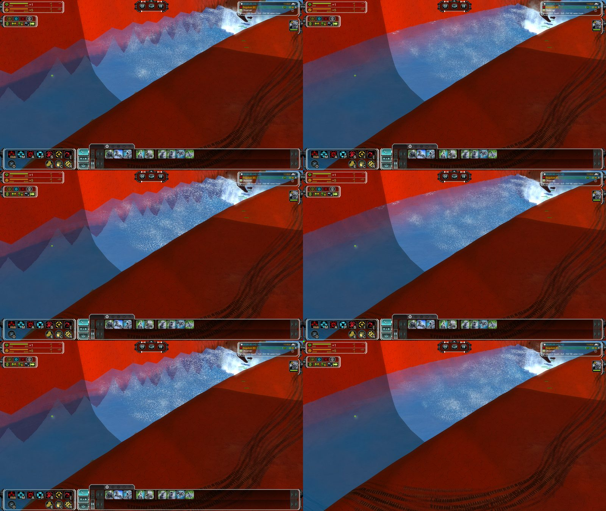
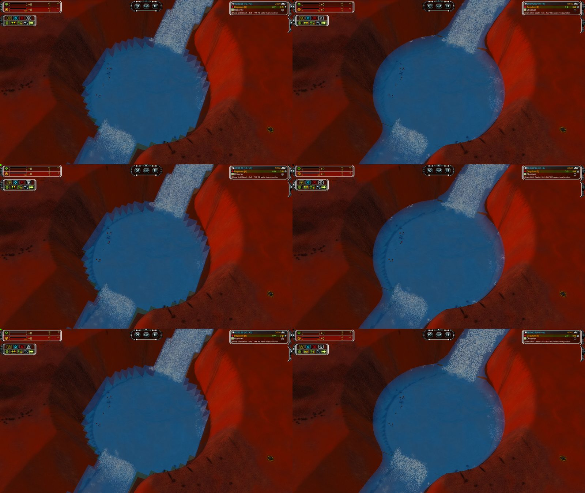

# Water simulation

Water that moves when things move in it: a damped wave simulation on the GPU, wakes of hulls, splashes of shells and sinking ships, wind waves, shore waves
and foam, and a reflection quality setting for the planar reflection. **Render only**: nothing here reads game state back into the simulation, so replays
and desync checks are unaffected. It works with the water bodies of [WATER_BODIES.md](WATER_BODIES.md) (lakes at their own levels); see
["Water bodies"](#water-bodies) for exactly what it does there and what is left.

| Part | Files (`src/moho/terrain/water/`) | Switch |
|---|---|---|
| The simulation, the projected grid, the `water2.fx` patch | `WaterSimulation.{h,cpp}`, `ShoreField.h`, `WaterSimParams.h`, `WaterShaderCommon.h` | `ren_WaterSim` |
| The simulation per water of a map with water bodies: the table of waters, the shore fields per water, the window centre | `WaterDomains.h`, `ShoreField.h`, `WaterBodySurfaces.{h,cpp}` (the owner texture) | `ren_WaterDomains` |
| What puts waves in: hulls, bodies, impacts, deaths | `WaterMeshFeed.{h,cpp}`, `WaterHull.h`, `HullFoot.h`, `HullOutline.h`, `HullDisplacement.h`, `WaterImpact.h`, `moho/sim/SimWaterEvents.{h,cpp}` | `ren_WaterSimWake`, `ren_WaterSimBody`, `ren_WaterSimImpact` |
| Where a source counts | `WaterSourceGate.h` | |
| Water Quality: reflection target size, filtered lookups, soft shoreline | `WaterQuality.{h,cpp}`, `WaterEffectPatch.{h,cpp}` | `ren_WaterQuality` |
| What the water shows of the scene: screen-space reflections, real-depth thickness, caustics, sheen, unit shadows | `WaterReflections.{h,cpp}`, `WaterReflectionPatch.{h,cpp}` | `ren_WaterSSR`, `ren_WaterAbsorb`, `ren_WaterCaustics`, `ren_WaterSheen`, `ren_WaterUnitShadows`; [WATER_REFLECTIONS.md](WATER_REFLECTIONS.md) |
| The edge of a lake or a river at the ground: the cut-out mask by the depth test alone, the mesh of a river grown over the pits beside it | `WaterBanks.h`, `WaterBankPatch.cpp`, `WaterBankGrowth.cpp`, `WaterBanksBind.{h,cpp}`, `WaterBodySurfaces.cpp` | `ren_WaterBanks`, `ren_WaterBankReach` |
| Shore cut-out and terrain tessellation near the water | `Shoreline.cpp`, `render/tess/CTesselator.cpp` | `ren_ShoreTessCoeff`, `ren_ShoreTessCell`, `ren_ShorelineCutoff` |
| The headless lab and the recorder | `tools/watersimlab/`, `tools/watersimlab.py`, `tools/waterrec.py` | |

## The simulation

A height-field wave equation on a grid of 1024 x 1024 cells of half a world unit (a window of 512 units) that follows the point of the water the middle of
the big world view looks at; the window moves in whole tiles of 8 cells, wraps (a toroidal buffer), and cells it moves onto start calm. State is
`float4 (height, last height, foam, land flag)` per cell in two structured buffers (16 MB each) that the compute shader `SimCS` ping-pongs; sources are two
`float4` each (position, radius, push; foam, kind). One step is 1/90 s of game time, at most 6 steps a frame; a pause (no game tick for a third of a second)
stops the water, and the speed of the game scales it. Waves travel at about 2.5 units a second, are damped, disperse a little (short waves run faster, so a
splash becomes a train of crests) and lose their shortest part to viscosity. A copy pass (`SimCopyPS`) turns the state into one RGBA16F texture (slope x,
slope z, height, foam) in the window.

* **Land is a wall.** A cell whose ground (bilinear raw height) is above the water level holds no wave, so a wave dies at the beach and nothing that happens
  ashore moves the sea. The height map goes to the GPU once and again when it changes (at most every 90 frames). On a map with water bodies "the water
  level" is the level of the cell's own water and the water of another level is a wall too, see ["Water bodies"](#water-bodies).
* **Normals.** `water2.fx` `HighFidelityPS` is patched (`PatchWaterSimulation`) so the ripples bend the normal before the reflection, the refraction offset
  and the sun glints read it (the bend is capped, `ren_WaterSimStrength`), and the wave crest colour (foam) follows the height and the foam channel.
* **Grid.** The water surface is a 255 x 255 projected grid instead of the 4-vertex quad: the vertex shader shoots each vertex along its screen ray onto the
  water plane (limited to the map) and lifts it by the simulated height (`ren_WaterGrid`, `ren_WaterDisplace`). The flat quad stays for the cut-out mask pass
  and when the grid is off. A map with water bodies draws one grid per water, see ["Water bodies"](#water-bodies).
* **Where it runs.** `WRenViewport::RenderWorldView`: after the mesh batch, `water::FeedWaterFromMeshes`, then `water::StepWaterSimulation`, before the reflection
  and water passes. It runs only for views with at least 200,000 pixels (the minimap and small views do not move the window). Direct3D 11, 12 and Vulkan; an API
  without compute (`kGpuFeatureCompute`) refuses with one warning and leaves the shipped water. The result texture is a 9 token render target
  (`DXGI_FORMAT_R16G16B16A16_FLOAT`).

## What puts waves in

All of it ends in `SimAddSource(x, z, radius, strength, foam, shown, kind)`, which keeps a source only where the place has water (`WaterSourceGate.h`, below)
and, unless `shown`, only where the local player sees (the vision circles of the focus army and its allies; an observer sees all): the waves would tell what
happens in the fog.

* **Hulls under way** (`WaterMeshFeed.cpp`, `WaterHull.h`): each unit or building mesh in the batch (the materials that draw into the shadow map, wreckage
  excluded) with a speed makes a wake from its oriented box and its waterline outline (`HullOutline.h`): a bow wave across the beam, a stern trough, the wash
  of the propellers and foam along the sides, plus the arms of the V that it leaves in the water. The size follows the hull (a battleship 0.4 units, a frigate
  0.03). The sources are weighed with the game time of the frame (`SimSourceWeight`), so the wake does not depend on the frame rate.
* **Displaced volume** (`HullDisplacement.h`, `HullFoot.h`): a body with a mesh pushes the water by the volume of its columns below the surface; what changed
  since the last frame in each one-unit bin goes in: a bow raises the water, a stern leaves a gap, a body that falls into the sea makes a splash. A body that
  is seen for the first time makes nothing happen. (This replaces the hand-made wake for meshes that have a volume: `ren_WaterSimBody 0` brings it back.)
  The file is called HullDisplacement because the engine's "water body" is a lake.
* **Impacts** (`WaterImpact.h`): a shell, bomb or torpedo that lands on or under the water (`Projectile::Impact`) and a hull that goes down (`Unit::Kill`) or a
  wreck that falls into the sea (`CUnitMotion`) throw a crater with a rim (no volume, so no mound is left to ring), a few smaller craters and mounds, and a
  burst of foam, sized by the cube root of the damage or the square root of the build cost. The sim files call `SimWaterImpact` / `SimWaterUnitDeath`
  (`moho/sim/SimWaterEvents.h`), which forward to a sink the water installs; headless installs none. The events of the player's own side and allies are shown
  where they happen, in the fog too (a dying unit takes its vision with it).

## The sea

* A wind sea of eight travelling waves with sharp crests bends the normals and drives the surf; it does not lift the mesh. Its headings, lengths and where its
  patches are come from a seed per map (`ren_WaterSeed`, 0 = from the map size and the sea level).
* **Shore field** (`ShoreField.h`): for every height sample the distance to the nearest land sample (exact Euclidean distance transform) and the fetch of the
  wind (how far the water runs upwind before it meets land). Shore waves, swash, beach foam and the calm of lakes and lees come from it; a lake of 60 units
  never gets the swell of the open sea.
* **Foam**: a channel that spreads a little and fades in a couple of seconds, thrown by sources, by breaking crests and by the surf at the beach, drawn as a
  noise-broken threshold (`WaterShaderCommon.h`: value and gradient noise, the foam look).

## Water Quality

`ren_WaterQuality` 0 to 3. Level 0 is the shipped renderer. The shipped pixel shader looks up the reflection (the mirrored units) and the refraction (the scene
before the water) with one bilinear tap at a position the wave normal has moved, and the finest normal layer repeats every 2 units, so neighbouring pixels land
several texels apart: reflected hulls shimmer and stair-step and the shoreline is a staircase of whole pixels.

| Level | Reflection target | Reflection taps | Refraction taps | Shoreline |
|---|---|---|---|---|
| 0 | screen size | 1 | 1 | binary |
| 1 Low | 0.5 x | 4 | 1 | binary |
| 2 Medium | 1 x | 4 | 4 | soft |
| 3 High | 1.5 x | 8 | 4 | soft |

The taps are spread over the screen-space derivative of the lookup position and the reflection taps are weighted by the reflection's alpha, so a reflected
edge fades into the sky and not into black. A water pixel next to land takes the land's colour by the share of its four neighbours that are land (soft
shoreline). The parameters reach the effect as `faf_WaterFilter`; `water2.fx` is patched when it is read (`WaterEffectPatch`), and a source the patch does not
recognise, or a patched source the backend rejects, builds as the shipped effect. Changing the level applies at once. The default is Medium on Direct3D 11, 12
and Vulkan and off elsewhere (the Direct3D 9 shader model has no room for the filter); there is no Options entry yet. The reflection target of a level that
resizes it is made on demand with its own depth buffer (`AcquireReflectionTarget`, hooked in `RenderReflections` / `RenderWater`); 1.5 x at 3840 x 2160 is
about 150 MB.

The patch order when `water2.fx` is read: wave simulation, then Water Quality. The cache name of the compiled effect carries a tag per patch applied
(`.watersim1`, `.waterq1`), so every combination has its own.

## Water bodies

A map with water bodies (`sim_FixWaterBodies`, [WATER_BODIES.md](WATER_BODIES.md)) has the sea and lakes at their own levels, and dry areas. What this simulation
does there, **as built**:

* It takes the map the renderer draws (`REN_GetTerrainRes()->mMap`, not the session's, so it also runs in the editor) and runs when the sea or any wet body
  exists; with no sea it is built for the first wet body's level. A map with no water at all leaves it off.
* `SimLevelAt(x, z, level)` is the water level at a place (`STIMap::GetWaterElevationAt`; the one level without bodies) and false where there is no water (a
  dry body, no sea outside the bodies). `SimAddSource`, the death splash and the hull and body feed all ask it: nothing is put in at a place with no water or
  ashore, and a hull or a body takes the level where it stands. The decision is `WaterSourceGate.h` (`LevelAtPlace`, `SourceOverWater`), shared with the lab.
* **One domain per water.** The simulation is one window of cells whatever the map holds; what changes is what a cell is made of. `WaterDomains.h` builds a
  table with an entry per block of 2 x 2 height-field cells (a texel of the water map: the unit of `WaterOfBlock`, which is also what the water meshes are made
  from, so a cell is simulated in the water that is drawn there): the level of its water in raw height units with the 0.1 margin of the land test taken off,
  and the number of the water (0 the sea, else the body; a dry body or a sea that does not exist has no level, every cell of it is land). The table is
  appended to the shore buffer as two more segments, the way the wind fetch is (all four read-buffer slots of a dispatch are in use), and made again when the
  bodies change (`CWaterBodies::Generation`). In `SimCS`:
  * land is ground above the level of the cell's own water, and the ground depth that clamps the waves, the beach foam, the swash and the surf amplitude is
    that level minus the ground;
  * a neighbour of another water is a wall, like land: the `w` channel of the state holds 1 for land and, for water, the tag of its domain (0 for the sea,
    minus the body number for a lake), so two waters of different levels that touch (bodies that are cut apart by an outline, not by land) stay apart and a
    wave is reflected at the border, as at a beach;
  * a source acts in the water it was made in only (the number of that water plus one is in a spare field of the source): a shell that falls in the sea does
    not push the lake next to it although its disc reaches it.
* **The shore fields per water** (`ComputeShoreDistanceDomains` in `ShoreField.h`): the same kernel as for the sea, run on the box of the samples of each water
  with a margin, where a sample is land when it is higher than the level of that water or belongs to another water. A lake gets its own distance to its own
  shore and its own fetch of the wind, so the surf and the beach foam of a lake follow its shore and a small lake stays calm (a lake of 20 units has a fetch
  below 25 everywhere, calm 0.08; the fetch of a lake of 60 units never exceeds its width, so its calm stays below 0.25 where the open sea has 1.0). The march
  of the fetch stops at the border of a water, so a pit below the sea inside the sea's box is not crossed by the wind of the sea. A map with one water gets
  exactly the old arrays.
* **The window centre** follows the point the middle of the view looks at, which with several levels is the first surface of any water that the centre ray
  meets (`WaterWindowCentre`: a march in steps of 8 units with a bisection, up to the ground; a ray that meets the ground first, goes up or sees no water
  keeps the last centre). On a map without bodies it is the point where the ray meets the sea plane, as before.
* **A map without water bodies is simulated as before, to the instruction.** `SimCS` has two variants. The text compiled for such a map has no part of the
  domains in it: `watersimlab --dxbc` shows that the code of the compute shader and of the copy pixel shader compile to the same bytes as the source before
  water bodies. The variant with `FAF_DOMAINS` is made the first time a map with bodies is played. (Without this the same lines compiled to other instructions
  and the GPU's last bits changed: a sea map's frames differed from the old build's in 2 to 9 percent of their pixels.)
* **One projected grid per water.** The surface pass of such a map draws, for each water in view (at most six a frame; the cap keeps a map with a great many
  small lakes from drawing a great many grids), the 255 x 255 grid at the level of that water, in the part of the screen that holds the rectangle of its blocks
  (`BindWaterGridLevel`, with a margin for the lift), so a small lake costs a small part of a grid's pixels. The grid covers more than its water, so
  `WaterBodySurfaces::OwnerTexture` makes an 8-bit texture with one texel per block holding the number of the water that owns it and the pixel shader (the
  `water2.fx` patch) drops the pixels of the grid that another water or dry ground owns, through the alpha test the water pass has. Waters that get no grid
  (past the cap, off the screen, `ren_WaterGrid 0`, `ren_WaterDomains 0`) are drawn as their meshes, as before, and the ripples bend their normals either way.
  The cut-out mask pass keeps the meshes. The simulation window is 512 units: a lake outside it has its grid at its level but no waves (the lift and the
  ripples are zero outside the window).
* `ren_WaterDomains 0` brings back the earlier behaviour on a map with bodies: one level of simulation (a lake above the sea is a wall, a lake below it sits
  in the sea's water, a hull on a lake makes no waves) and the meshes.
* **Shoreline and tessellation** work per block level: a shore cell is cut at the water level of its own block (the sea's or its body's), a dry body has none,
  and the tessellator refines a node near any of the levels of its tile (`WaterBodyCrossesTile` tells it whether a body crosses or is near).

The light field and the sun shadow under water read the level of each cell's water ([LIGHTING_V2.md](LIGHTING_V2.md), "Water bodies"). A hull that stands on two
levels (a bridge) takes the level of its centre.

Without water bodies none of this is in the way: `SimLevelAt` is the sea level everywhere, the grid draws one plane, and the compute shader is the one that
never had bodies.

## The tint under the water

The terrain's blue tint under water (`ApplyWaterColor` in `terrain.fx`) takes its depth from the G channel of the water map, baked per 2 x 2 block from one
corner height, and tests the pixel against `WaterElevation`. On a map with water bodies the bake gives a block with any corner above its water no depth and the
shader's level is the highest of the map, so the tint showed the 2-unit grid as steps and left a line of tint on the bank of a lake below the highest level.
With bodies the terrain computes the depth per pixel instead:

* `WaterBodySurfaces::LevelTexture` makes one B8G8R8A8 texel per block (`WaterLevelTexel.h`): the level of the block's water in the low 16 bits and its abyss in
  the high 16 bits, 1/128 unit, 0xFFFF no water; rebuilt with the bodies (`Generation`). The terrain classes bind it to `UtilityTextureC` instead of the water map
  (`water::BindTerrainWaterMap`) and set `fafWaterLevelParams` (x: on, y z: size in texels).
* `TerrainWaterLevelPatch` rewrites the twelve reads of the water map's depth in `terrain.fx` into `FafWaterDepth(shipped fetch, uv, height)`: the texel is read at
  its centre (so the linear filter returns it unmixed, through the same sampler: **no new sampler**, which matters on Direct3D 11's 16) and the depth is
  `(level - height) / (level - abyss)` at the pixel's own terrain height, 0 above the water. Every use of the depth (the tint, the PBR `underwater` term, the decals)
  follows. `fafWaterLevelParams.x` 0 returns the shipped G channel: a map without bodies is the shipped shader.
* terrain.fx is patched **only while the map being drawn has water bodies**: `water::ApplyTerrainWaterLevelsLive` (called each frame next to the lights' live
  switch) rebuilds the effect when that changes, so a map without bodies has the shipped effect text and compiles to the shipped frames on every API (an
  always-patched effect changed the Vulkan frames of sea maps slightly: the compiler turns the same lines into other instructions). The rebuild is
  one effect compile (tens of milliseconds on Direct3D 12, longer on Direct3D 11) at the start of such a map.
* The patch is the first of the terrain chain (the shadow filter and the light patch continue from its text), independent of Dynamic Lights, on the Direct3D 10
  dialect backends; `FAF_NO_RENDER_ADDITIONS=1` leaves terrain.fx alone, and so does a source it does not recognise. `ren_TerrainWaterLevels 0` brings back the
  baked depth live. The water surface keeps reading the baked water map (its depth, foam and flatness).

## Rivers

A river (`River` key of a water body, `sim_FixRivers`; [projects/RIVERS.md](projects/RIVERS.md)) is a water whose level is not one number. What the water does with it, **as built**
(render only; the sim part is in [WATER_BODIES.md](WATER_BODIES.md)):

* **The block has its own level.** `WaterOfBlock` returns, for a river's block, the mean of its four corners' levels (`RiverBlockCorners`: the river's level field at the even vertices) and the shading
  depths `deep` and `abyss` as far below it as the river's highest level had them. The baked water map (depth, shore), the domain table of the simulation and the shoreline cut-out all come from it, so a river
  shades by its own depth. Sea and lake blocks are what they were.
* **The mesh.** A river is drawn as its own mesh, never as a projected grid: a quad for every cell of its blocks, the four corners at the river's level there (`RiverBlockVertices`, one vertex lookup each), so the
  surface is the one `GetSurfaceHeight` sees. The water vertex shaders keep a vertex's own height while `waterRiverParams.x` is 1 (`inPos.y = waterRiverParams.x > 0.5 ? inPos.y : WaterElevation`); every other
  draw takes `WaterElevation` as before. The planar reflection is never a river's (a sloped surface has no mirror plane): the sky and, with `ren_WaterSSR`, the screen-space reflections serve. The caustics, the
  real-depth thickness and the sun shadow read the world position of the pixel (`ViewPosition - inV.mViewVec`), which is the sloped surface's, so they follow it. The shoreline cut-out of a river block is
  made at its exact level and drawn at the level rounded to an eighth of a unit (`RiverShoreLevel`), because the cells are drawn grouped by level, one draw each.
* **The simulation window carries rivers.** Ripples bend the normals of a river as they do those of any mesh. The domain table has the level of each block, and the shore fields of a river's domain
  (`ComputeShoreDistanceDomainsSloped` in `ShoreField.h`) are made against the level of each sample's own block instead of the one level of the domain's first block; the calls of a flat domain compile to the same
  instructions and give the same bytes (checked in `tools/watersimlab` `domains` 9). The compute shader is not changed.
* **Flow.** One A8R8G8B8 texel per 2 x 2 block (the layout of the water map; `RiverFlowTexture`): r, g the unit direction (the sim's `FlowAt`), b the speed over 6 units a second, a 0 without a river else 16 to 255
  for the turbulence. The speed is Manning's relation for an open channel, `v = d^(2/3) sqrt(S) / 0.04` (`S` the drop per unit of run along the flow, from the river's level a unit either side of the block;
  `d` the depth, at least 0.05), times the river's `FlowScale`, at most 6 units a second; a level reach does not flow and a fall block runs at 6 and is white. The turbulence is
  `smoothstep(0.04, 0.10, S)` plus the shallow term `(1 - smoothstep(0.05, 0.5, d)) * smoothstep(1, 2.5, v)` (fords and the margin of a bank), at most 1.
* **The pixel shader** (`PatchWaterRivers`, `RiverFlowPatch.cpp`, applied after the wave simulation patch, anchors on lines of the shipped shader exactly once, a no-op while `waterRiverParams.w` is 0, which a
  map without rivers keeps): for a pixel in a river the four normal layers are read again at `(xz - flow * phase) * repeat` in two phases of three seconds that run half a period apart, blended by
  `1 - |1 - 2 t|` (zero where a phase restarts, so nothing pops; the design text had the weight the other way round, which pops) with the contrast the blend takes put back, and faded in by the river's weight at the
  edge. The clock is the game's (`Time`), so the flow stops with the pause. The white water is the shipped foam pattern (`FafFoamAmount`) at an amount of `turbulence^2 * ren_RiverFoam`, on coordinates that run with the
  flow. 8 extra reads and one flow read per pixel of a river, one branch on a constant elsewhere.
* The low and medium fidelity vertex shader has the same one-line patch, so those techniques should draw the sloped mesh too (they do not flow); this was not run.

## Banks

Where a river or a lake meets the ground its edge is the true intersection of the water level with the terrain, cut per pixel. Before this the edge of a body followed the outline of the
water map's 2 x 2 blocks: a staircase along a river, saw teeth where a diagonal bank crossed the blocks, and a faint tinted band of ground beyond the water. Render only (nothing here is read
by the sim); the sea and a map without water bodies are not affected. Files: `WaterBanks.h`, `WaterBankPatch.cpp`, `WaterBankGrowth.cpp` (pure, host tested), `WaterBanksBind.{h,cpp}` (the
console variables and the shader variable), `WaterBodySurfaces.cpp` (the cache of the grown vertices); `ren_WaterBanks`, `ren_WaterBankReach`.

What made the staircase, found on `faf_re_waterrivers` (a canyon whose river is 5 units deep, the bank rising 12 units in 14):

* **The mesh stopped in the air.** A river's wet vertices are the ones within its half width of the centreline whose terrain is below its level (`CWaterRiver`), a rule of the sim that keeps a river
  out of the basin behind a ridge. The terrain of a channel may lie below the river's level further out than that (here up to 7 units: the ground at a bank is 4.7 below the water beside it), and
  the plane of the river ended at the outline of the cells that own a wet corner, with the lower ground beyond it uncovered: a vertical wall of water seen from above as a staircase of cells and blocks.
* **The mask of the block.** The shoreline cut-out is the alpha of the refraction target that the water pass reads (`mask = saturate(a * 255)`, the pixel is water where it is 0). The mask pass
  (`TWaterLayAlphaMask`) lays it where the water plane is nearer than the terrain **and** the point-sampled blue channel of the water map is 0, and the polygons of the shoreline pass lay it in the
  blocks where it is not (a straight line between the four corners of the block, two units apart; the odd vertices are not read). Between them the edge follows what the block map and the polygon say, not what the terrain does.

What it does now:

* **The mask of a lake or a river is the depth test alone** (`PatchWaterBanks`, `WaterBankPatch.cpp`): `WaterLayAlphaMaskPS` returns a cleared alpha for every pixel it is asked about while
  `waterBankParams.x` is 1, so a pixel is water where the plane of the body is nearer than the terrain's depth, exact to the pixel, wherever the mesh of the body covers it. `HighFidelityWater::RenderWaterLayerAlphaMask`
  sets the variable around the draws of the bodies' meshes (`BindBankMask(!level.sea)`); the sea's mask, on a map with water bodies as on any other, stays the shipped one. The patch is one declaration and one line
  of the stock source (anchored exactly once; chained after the river patch, cache name `.waterbank1`), a branch on a constant at run time while the variable is 0. The shoreline polygons are still drawn
  and harmless: they are inside the blocks the mesh covers.
* **The water of a body reaches the ground** (`GrowBanks`, `WaterBankGrowth.cpp`). From every wet vertex of a river or of a lake with water (a dry body has none to grow), ring by ring (four-neighbour steps, so
  what joins is connected to the water), a vertex that no body owns joins it when its terrain is below the level of the body **there** and not below the sea (the sea has it). A river's level is its field where it
  has one and otherwise the level of the nearest point of the centreline (the way the field is made, carried on past its support: a bank takes the level of its own cross-section, not the level of the water it was
  reached from, which at a fall would lift a fan of upstream level beside the pool below), and a vertex counts while it is within the half width there plus `ren_WaterBankReach` units (8); a lake's is its level,
  as many cells (8) from its water. The ground above the level stops the growth, so the pit is exactly what is below the plane; a pit the reach does not cover ends at a plane edge in the air as before. Where the
  sim stops a lake at its outline or bounds with lower ground beyond it (the test map `faf_re_waterrivers_junction`: a round pool whose outline cuts a bank four cells wide) the water now runs on to the ground.
  On `faf_re_waterrivers` the growth is 1299 vertices and does not change between a reach of 8 and 24: the pits there end at the ground; on the junction map 954 vertices; on `faf_re_waterlevels` 26.
* **One source of truth.** `WaterOfBlock` is what every render consumer reads (the meshes, the owner and level textures of the terrain tint, the baked water map, the shoreline, the domain table of the
  simulation, the light field), and the grown vertices are folded into it: a block that no body owns takes the lowest river among the grown vertices of its nine (a block a body owns keeps it, so a river
  beside a lake takes nothing of the lake), and `RiverBlockVertices` takes a grown vertex's level for a river's corner. The mesh, the tint under the water and the shoreline therefore agree on the extra
  blocks. The cache is made when a map's bodies are first read (`CWaterBodies::Generation` is its key; the console variable is read then), under a lock; a body beside no pit grows nothing.
  The sim does not see any of it: a unit on the ground beside a river that is shown as water there is on dry ground by the sim's rules. This is the cost of showing the true intersection and the
  reason for the reach and for the switch.
* **Flow.** The flow texture is made from the sim's blocks; the grown blocks have no flow (weight 0, the shipped normals) and fade in over their texel like the edge of any river.

| `ren_WaterBanks` | What |
|---|---|
| 0 | The earlier edge: block outline, shore polygons |
| 1 | The mask of a lake or a river is the depth test alone (live) |
| 2 (default) | And the mesh of a river or a lake reaches the ground below its level beside the water (read when a map's bodies are first drawn) |

`FAF_NO_RENDER_ADDITIONS=1` turns both parts off at run time (the patch is still compiled in, the variable stays 0 and nothing grows).

### Checked in a game (2026-11-12)

Windowed 1600 x 900, `tests/featab`-style scene runner (camera snapped by a test hook, frames dumped each second), `sim_FixWaterBodies=1 sim_FixRivers=1`, run folder `bin_x64_fixbanks`, Direct3D 11, 12 and Vulkan.
Frames and composites are kept with the work of the change; two are in `docs/images`.

| Map | What | D3D11 | D3D12 | Vulkan |
|---|---|---|---|---|
| `faf_re_waterrivers` (river A, a canyon with a 12 unit fall) | five cameras: along the bank, across the fall, the pool, top down, far; shipped edge against the new one | yes | yes | yes |
| `faf_re_waterrivers_junction` (a round pool with an outline between two reaches) | the pool from above and from far, `ren_WaterBanks 0` against 2 | yes | yes | yes |
| `faf_re_waterlevels` (crater lake, pools, a river) | the shores, the same cameras, shipped against new, and the switch live | yes | yes | yes |
| `adaptive_acid_lakes` (the sea, no bodies) | the cut-out of the sea with the switch at 0 and 2 | yes | | |




* **The river** loses its staircase on both banks on all three APIs: the water edge follows the canyon wall and the foot of the bank as a smooth line, the tinted wedges of ground beside it are gone, and nothing is
  missing at the bank (no gap between the water and the wall). The foam band of the rapids, the screen-space reflections, the caustics and the tint under the water of the terrain are as before.
* **The round pool** of the junction map (954 grown vertices, the outline of the pool cuts a bank four cells wide with ground 3 to 5 units under the level) had a saw-tooth outline of blocks and now has the round
  edge of the terrain.
* **The lakes of `faf_re_waterlevels`** were smooth on the shipped edge already except where a steep bank crosses the blocks; with the banks on the three pools and the crater lake look the same (26 grown
  vertices), and the straight edge of the crater lake in the close views is a vertical cliff of the map, not the block outline.
* **The sea.** With the switch live between 0 and 2 on a paused frame of the acid-lakes map the frames differ by 0.10 to 0.13 percent of the pixels, as consecutive paused frames of one run do (0.12 percent); the
  switch does not touch the sea's mask. Across runs the build with the patch (`ren_WaterSim 0`) against the build launched with `ren_WaterBanks 0` (no patch) differ by 0.36 to 0.43 percent of the pixels of the
  frames that are aligned, and two runs of the patched build against each other by 0.33 percent (the pause lands on another tick: 14.20 against 14.13 seconds), two runs of the unpatched build by 0.07 to 0.13
  percent (14.01 against 14.04). That is the noise of the pause, **not** a proof of identity: the paused tick could not be matched between the patched and the unpatched build; what is certain is that the patch
  changes one return line of the mask shader and that the line returns the shipped value while `waterBankParams.x` is 0, which it is except around the draws of a body's mask.
* **Reach.** On the river map the growth is the same 1299 vertices with a reach of 8 and of 24 units: the pits end at the ground. A first version that gave a grown vertex the level of the water it was reached from
  (not of its own cross-section) made a fan of upstream level beside the pool below the fall at a reach of 24.
* **Not checked:** GPU timings (the grown meshes are 1284 more quads on a 5480 quad map, and the mask pass draws a body's pixels without the block test); a split-screen view; the editor's view of the water; a
  river that borders the sea; the low and medium fidelity water; the sea on Direct3D 12 and Vulkan with the switch (the shader is the same text); a map whose river runs through a wide basin below its level (the
  reach is what stops it flooding: it is 8 units).

## Console variables

All render only, live unless noted.

| Variable | Default | What |
|---|---|---|
| `ren_WaterSim` | 1 | The simulation; 0 the shipped water. The shader patch applies at the next map load |
| `ren_WaterGrid` | 1 | The projected grid (one per water on a map with water bodies); 0 the flat quad or the meshes |
| `ren_WaterDomains` | 1 | A map with water bodies: each water (the sea, every lake at its own level) is simulated in its own domain and drawn with its own grid; 0 the earlier behaviour (one level of simulation, the water bodies drawn as flat meshes). Live |
| `ren_WaterDisplace` | 100 | How far the simulated height lifts the geometry, percent |
| `ren_WaterSimStrength` | 100 | How strongly the waves bend the normals, percent |
| `ren_WaterSimWake` / `ren_WaterSimFoam` | 200 / 100 | Strength of hull wakes / foam of ships, percent |
| `ren_WaterSimBody` / `ren_WaterSimBodyFoam` | 100 / 100 | Push of displaced volume (0 = hand-made wakes) / foam where bodies enter and leave, percent |
| `ren_WaterSimImpact` | 100 | Splashes of shells and deaths, percent |
| `ren_WaterSwell` / `ren_WaterShoreWave` / `ren_WaterSolid` / `ren_WaterSeed` | 100 / 100 / 25 / 0 | Wind sea height, shore waves, least colour of the water over the bed, the seed of the sea |
| `ren_WaterSimCapillary` / `ren_WaterSimDamping` | 100 / 100 | Dispersion and damping, percent of the tuned value |
| `ren_WaterBanks` / `ren_WaterBankReach` | 2 / 8 | The edge of a river or a lake where it meets the ground: 0 the block outline of the shipped cut-out, 1 the cut-out mask of a body is the depth test alone (live), 2 also the mesh of a river or a lake reaches the ground below its level beside the water (read when a map's bodies are first drawn); the reach in units past a river's half width, cells from a lake's water (see "Banks") |
| `ren_River` / `ren_RiverFlow` / `ren_RiverFoam` | 1 / 100 / 100 | Rivers: sloped surface, flow and white water on/off (the shader patch applies at the next map load), speed and whiteness in percent. `ren_RiverDebug` (0) shows the flow texture and the scrolled layer |
| `ren_WaterQuality` | -1 | 0 to 3; -1 the default of the API (Low, 1, on Direct3D 11, 12 and Vulkan) |
| `ren_ShoreTessCoeff` / `ren_ShoreTessCell` | 0.1 / 0.002 | Terrain refinement near the water level (see below) |
| `ren_ShorelineCutoff` | 0 | Distance beyond which shore cut-out cells are skipped; the shipped 1000 dropped far coasts in blocks, 0 never fades |
| Diagnostics | 0 | `ren_WaterSimLog N` (reads the state back: stalls the GPU), `ren_WaterSimTest`, `ren_WaterSimImpactTest` / `Size` / `Burst`, `ren_WaterSimHullTest`, `ren_WaterMaskDebug` (1 paints the discarded cut-out, 2 the drawn water), `ren_WaterRec N` / `ren_WaterRecEvery` |

## Shore cut-out and terrain tessellation

The water pass is cut by the land with shoreline polygons (`Shoreline.cpp`) and the terrain tessellator (`CTesselator.cpp`) chooses the nodes. Four retail limits
showed as holes and missing blocks in the water, and are changed here: the shoreline sheet held 0x3000 vertices and 4094 triangles (0x30000 and 65000 now, the
GPU sheet uploads only what a frame writes); shoreline cells further than 1000 units were skipped (`ren_ShorelineCutoff` 0); the marching-squares polygons
left the saddle cells without any polygon (a cell counts as a shore cell when any of its nine samples is on the other side of the level than the highest or
lowest, and its polygon is the whole cell: it only has to cover what is under water, the depth test cuts exactly); and a coarse terrain node that crosses the
water level could bridge a canyon or a broken shore by the error the view allows, so the water mask cut a square hole in the sea. The tessellator refines such
a node: `ren_ShoreTessCoeff` keeps only that share of the screen error for a node whose height range is within its own error of a water level, and
`ren_ShoreTessCell` splits a node that crosses a water level until it is two or three pixels wide (the terrain shader flattens submerged vertices, so a coarse
ramp stays above the water over its whole width; the error test cannot see that). Measured on the render-all tree before the merge (zoomed out at distance 1000):
the discarded water band fell from 15,730 to 10,310 pixels with the cell split. After the merge with water bodies, both tests take every level of the tile.

## Lab and recorder

`tools/watersimlab/` is a headless lab (D3D11 on WARP, no game): it reads the HLSL raw string of `WaterSimulation.cpp`, compiles the real compute shader, shares
`ShoreField.h`, `WaterDomains.h`, `WaterHull.h`, `WaterImpact.h`, `HullDisplacement.h`, `WaterSimParams.h` and `WaterSourceGate.h` with the game and writes captures in the format of the
in-game recorder (`ren_WaterRec`, read by `tools/waterrec.py`).

```
powershell tools/watersimlab/build.ps1                      # builds tools/watersimlab/watersimlab.exe (MSVC)
python tools/watersimlab.py selftest                         # a coast for 40 s: finite, in range, crests not aligned with the shore, foam on the shore; then `gate`
python tools/watersimlab.py gate                             # where sources count, on a mock map with water bodies (pure CPU)
python tools/watersimlab.py impact --check                   # open sea, a splash: ringing, volume, front speed, foam, checks
python tools/watersimlab.py wake --body                      # open sea, one hull sails through: wave height and foam behind it
python tools/watersimlab.py domains                          # the simulation per water of a map with water bodies: 33 checks in 9 groups (below)
watersimlab.exe --src src/moho/terrain/water/WaterSimulation.cpp --dxbc
                                                             # the hash of the compiled code of the compute shader and the copy pixel shader
```

`domains` runs the real compute shader on WARP over synthetic maps (a 256 x 256 unit window, several waters) and the pure-CPU parts of the same design
(`tools/watersimlab/domains.h`, `domains_cpu.h`; the CPU part is also the host test `faf_water_domain_tests`, 11 checks):

| # | Check | Result it needs |
|---|---|---|
| 1 | Parity: the coast of the lab (swell, shore waves, a pulse), 240 steps, with domains off, and with a one-domain table; the shore arrays of `ComputeShoreDistance` and `ComputeShoreDistanceDomains` | the same four state hashes; the arrays equal bit for bit. The same hashes come out of the shader source before water bodies |
| 2 | Two basins at levels 25 and 40, the ground 5 below each, a wall between; a zero-volume pulse in one | the other holds exactly zero; the first is alive after 3 s and its volume stays zero |
| 3 | Two waters side by side on flat ground with no land between (levels 25 and 40); a source whose disc reaches over the border; a crater next to the border with and without it | the water across the border stays exactly zero; with the border A keeps more of the waves than without |
| 4 | A dry polder (no water) 60 x 60 units at the height of the sea bed inside the sea; a source made in it | every cell of it is land, no height, no foam; the sea around it is alive; without domains the sea floods it (control); the source gate drops the source |
| 5 | Two bowls with sloped beaches at levels 25 and 40; shore waves on | the land / water edge of each is within half a cell of the contour of its own level (measured 0.1 unit); foam on both beaches; none on the wall |
| 6 | The fetch field: lakes of 20 and 60 units, the open sea, a pit below the sea | 20 units: fetch 7.2, calm 0.08; 60 units: fetch at most 45 (its width), calm at most 0.14; open sea 220, calm 1.0; the fetch of the sea ends at the pit's border (19.6 against 120.6 when the pit is not a domain) |
| 7 | `ComputeShoreDistanceDomains` against a brute-force nearest-foreign-sample reference (smoothed alike) and a whole-map field with the other waters as land (the fetch), on 4 random domain maps | no sample differs (distance within 2e-3, fetch equal) |
| 8 | `WaterWindowCentre`: the sea only, above a raised lake, a ray that goes up, meets no water, meets a ridge | the plane intersection to 2e-5 units; on the lake's surface (level 40) not at the sea plane; the others keep the last centre |
| 9 | The source gate against the shader's land test on 10,000 random places | every mismatch is within a cell of a contour or a block border (20 of 10,000, none further) |

`WATERSIMLAB_ONLY=fetch,brute,centre,parity,basins,dry,beach,gate` runs part of it. `--dxbc` shows that the old and the new source (without `FAF_DOMAINS`) compile
to the same instructions, `SimCS` 52,536 bytes and `SimCopyPS` 18,004 bytes of code; only the constants block that names the new `sG` differs.
`WATERSIMLAB_OUT` (default: a folder in the temp directory), `WATERSIMLAB_EXE` and `WATERSIMLAB_SRC` move the output, the executable and the shader source.
`tests/water/WaterEffectPatchTests.cpp` (target `faf_water_tests`, `FAF_STOCK_FX_DIR` = the folder with the stock `water2.fx`) checks the filter patch against the real
shader.

## Not part of this change

Screen-space reflections of the scene in the water, the water's thickness from the real scene depth, caustics and unit sun shadows on the water are in
[WATER_REFLECTIONS.md](WATER_REFLECTIONS.md) (they read the simulation's slope when it is in the shader, and nothing else of it). The light-field and ambient-occlusion terms
that depend on the water level are left to the light field.

## Verified, and not

Run for the per-water simulation and grids (Direct3D 11, 12 and Vulkan, windowed 1600 x 900, `tools/scenarios/water-levels` with `sim_FixWaterBodies=1`: the crater lake at
30, three pools at 23, 20 and 17, a river at 14, the sea at 3, a dry polder):

* The lab (`watersimlab.py domains`, 33 checks; `selftest`, which runs the old checks too) and the host test (`faf_water_domain_tests`, 11 checks), above.
* **A map without water bodies is unchanged.** The compiled code of the compute shader and of the copy pixel shader is byte for byte the old one (`--dxbc`). In a
  game on Direct3D 11 (an acid-lakes map, three views, the game paused at the same time) frames of the new build differ from the old build's by 0.1 percent of the
  pixels, as two runs of the old build differ from each other (0.1 to 0.26 percent); before the two variants of `SimCS` they differed in 2 to 9 percent.
* **Vulkan on a map without water bodies, against the base build (checked 2026-11-12, `fix/left`).** An earlier check on Vulkan found 0.07 to 0.29 percent sparse pixels
  different from the base build (`visuals`) with `ren_WaterSim 0`, where Direct3D 11 and 12 gave 0.000. It is not a water effect and not a Vulkan compile difference. The
  effect text of the new build differs from the base's on this map in `mesh.fx`, `particle.fx`, `terrain.fx` and `water2.fx` (`FAF_EFFECT_DUMP_DIR`, the generated HLSL, 0.2 to 0.9 KB each), and what
  differs in `terrain.fx` is the shadow filter patch (the terrain depth written as z / w, the ground's own margin and receiver plane, the lookups) and the lights patch
  (`DynFieldWaterLevel`, a branch that returns `WaterElevation` where the field carries no levels), none of it reached with the filter and the lights Off; the water
  levels patch of `terrain.fx` is not applied on a map without bodies (`TerrainWaterLevelsWanted`). The pixel difference sits inside the noise of one build: on the same
  scene (terrain only, no units, game paused, `ren_WaterSim 0`, the view's 1300 x 430 pixel centre) consecutive frames of one build differ in 0.4 to 0.7 percent of the
  pixels on Vulkan and on Direct3D 12 alike (the animated terrain details). Pixels that differ between base and new and do not change between frames of either build: 158 (0.028 percent) on
  Vulkan and the same 158, in the same box, on Direct3D 12 (their cause was not found; the same on both APIs, so not a Vulkan compile difference). So there is no Vulkan-only difference to explain; the
  earlier figure is the noise floor. Not done: the compiled SPIR-V of `terrain.fx` of the two builds was not compared (only the HLSL text was).
* **Each water has its own waves.** An impact test at the middle of the view (`ren_WaterSimImpactTest`) in the middle pool (sources carry domain 4, the pool at 20) puts the energy
  of the recorder's height field in that pool from 0.005 to about 1.5 (peak height 0.25) and leaves the pools at levels 23 and 17, a few units of land away, at 0.001 to
  0.006 (their own surf, with the shore waves and the swell switched off a few seconds before it still dies out): no response to the impact, on all three APIs. An impact
  in the crater lake leaves the pool at 23 at 0.000. With `ren_WaterDomains 0` the same views show no simulation in any lake. The recorder's sheets show three separate
  waters, the land between them grey. Frames: `ren_WaterSSRDebug 7` (the height) and `8` (the foam), with and without domains.
* **Nothing is drawn over dry ground.** The dry polder shows no water with domains on or off (`ren_WaterMaskDebug 2` paints every drawn water pixel green: each lake, the
  river and the bay are filled with green to their shore and the polder has none; the same on the three APIs). With `sim_FixWaterBodies=0` the sea floods the polder and the
  lakes and the river are dry ground, as before bodies existed.
* **The sea keeps its swell and surf** (the bay views: foam along the shore, the swell in the normals), with and without bodies.
* A ship that stands in the crater lake leaves a faint wake in the height view of its lake (seen on Vulkan; the feeds take the level of the lake at the hull).

Not verified: the GPU time of the extra grids and of the domain variant (no timings were taken: other games ran at the same time); the editor; a session of a map with
bodies followed by one without in one process (the effect patch is made once; the domain variant of the step is made when first needed); Direct3D 9 (not a target);
the interaction of the simulation's own shore surf with the shipped wave generators (`.scmwaves`) on a map that places them; the D3D12 / Vulkan shoreline sheet at 0x30000
vertices (4.7 MB) on a long coast; waters beyond the 512 unit window (they have their grid and no waves, by design, not looked at on the three APIs); more than six waters
in view at once (the sixth and later are meshes, checked by reading the code and by the cap, not by a map that has seven in view).
